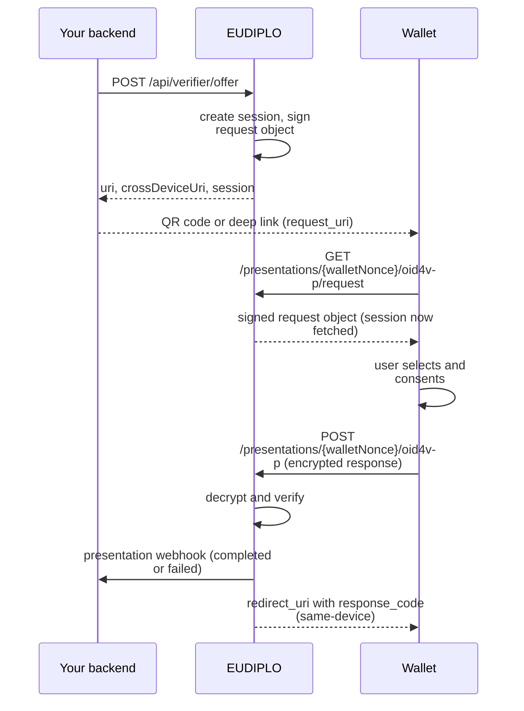
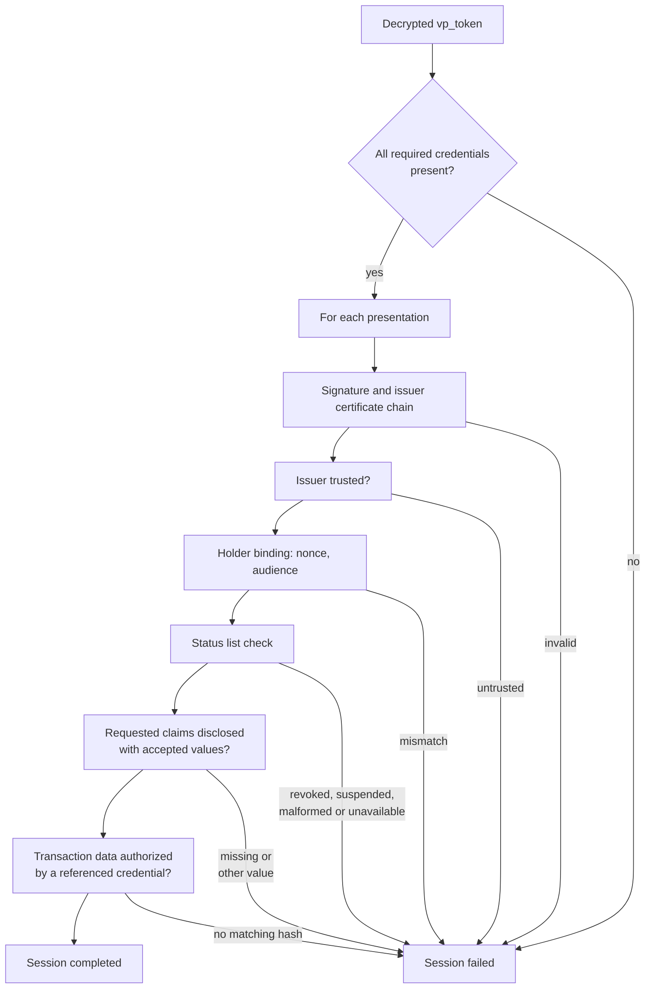
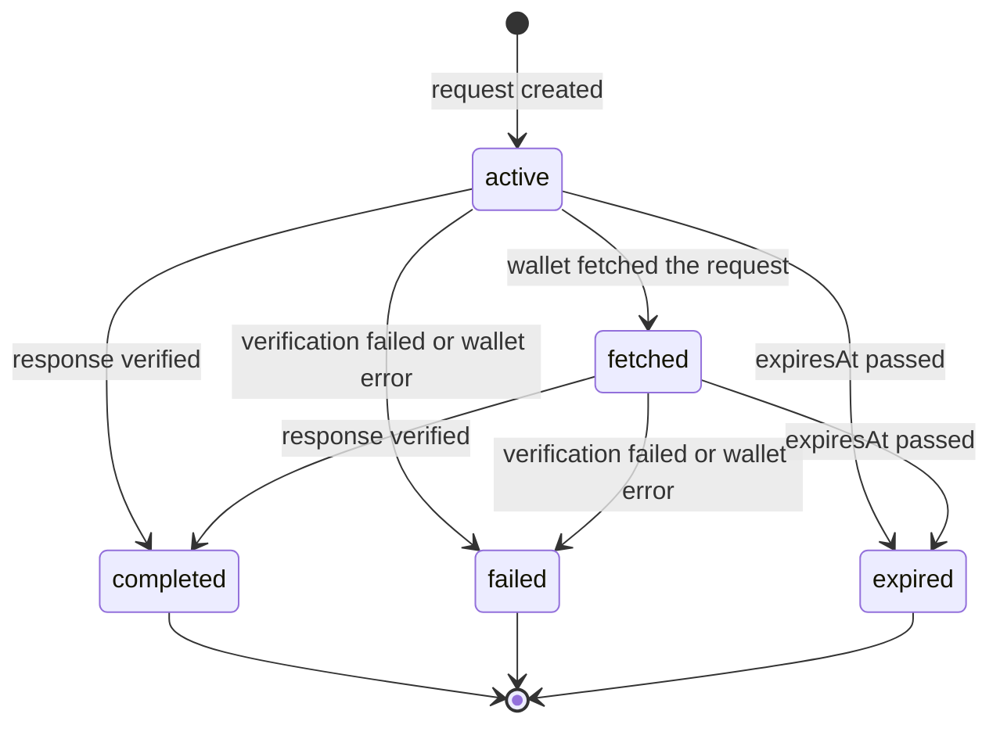

# Presentation under the hood

This page explains what EUDIPLO does during a presentation: the message flow, what the request object contains and how a response is verified. To set up verification, start with the [presentation guides](../presentation/index.md); supported features are listed in [Supported protocols](../reference/protocols.md).

## Flow



`POST /api/verifier/offer` creates the session and signs the request object right away. The response contains `uri` for same-device use, `crossDeviceUri` for a QR code shown on another device, and the `session` ID your backend uses to read the result. Fetching the request through `crossDeviceUri` (its path ends in `/request/no-redirect`) removes the redirect URI, so the wallet does not open the relying party's page on the phone after a cross-device presentation.

The wallet-facing URLs contain a `walletNonce`, not the session ID; [Sessions](sessions.md#session-binding-oid4vp-133) explains why.

## Request object

The request object is a JWT with `typ: oauth-authz-req+jwt`, signed with the algorithm of the `access` key chain (`ES256` unless the key chain uses P-384 or P-521) chosen when the request was created ([which one](../trust/keys-and-certificates.md#default-access-key-chain)), whose certificate chain is in the `x5c` header; with the `openid_federation` client identifier, the header has no `x5c` and the wallet picks the key by its `kid` ([OpenID Federation](../trust/federation.md#oid4vp-requests-with-a-federation-client-identifier)).

```json
{
    "response_type": "vp_token",
    "response_mode": "direct_post.jwt",
    "client_id": "x509_hash:<hash of the access certificate>",
    "response_uri": "https://eudiplo.example.com/presentations/<walletNonce>/oid4vp",
    "state": "<walletNonce>",
    "nonce": "<random UUID>",
    "dcql_query": { "credentials": [{ "id": "membership", "format": "dc+sd-jwt", "meta": { "vct_values": ["urn:example:membership:1"] } }] },
    "client_metadata": {
        "jwks": { "keys": ["<ephemeral ECDH-ES public key>"] },
        "encrypted_response_enc_values_supported": ["A128GCM", "A256GCM"],
        "vp_formats_supported": {
            "dc+sd-jwt": {
                "sd-jwt_alg_values": ["ES256", "ES384", "ES512"],
                "kb-jwt_alg_values": ["ES256", "ES384", "ES512"]
            },
            "mso_mdoc": {
                "issuerauth_alg_values": [-7, -35, -36],
                "deviceauth_alg_values": [-7, -35, -36, -9, -51, -52]
            }
        }
    }
}
```

What EUDIPLO adds to the configured DCQL query:

- **`client_id`** is derived from the access certificate: `x509_hash` by default, `x509_san_dns` if the request asks for it; `openid_federation` uses the tenant's federation entity ID instead.
- **Response encryption key.** Each session gets a fresh P-256 key pair. The public key goes into `client_metadata.jwks`; the private key is stored encrypted in the session and deleted when the session ends. With `openid_federation`, the wallet encrypts to the tenant encryption key from the federation metadata instead.
- **`nonce`** is a random value per request; the wallet must bind its presentation to it.
- **Trusted authorities.** `etsi_tl` entries in the configuration reference trust lists. In the request they become `aki` values, the key identifiers of the issuer certificates listed in those trust lists; trust lists whose issuers cannot all be expressed that way are also sent as `etsi_tl` URLs, and outdated trust lists are left out ([What the wallet receives](../trust/trust-lists.md#what-the-wallet-receives)). See [DCQL](../presentation/dcql.md).
- **Optional parts:** `transaction_data` (from the request or the configuration), and a registration certificate in `verifier_info` if the configuration requests one.

### Delivery variants

| Variant                  | How the request reaches the wallet                                                         | Where the response goes                                         |
| ------------------------ | ------------------------------------------------------------------------------------------ | --------------------------------------------------------------- |
| `uri`                    | `openid4vp://` link with `request_uri`, as QR code or deep link                            | The wallet posts to `response_uri`                              |
| `dc-api`                 | Your page passes the request object to the browser's Digital Credentials API; `response_mode` is `dc_api.jwt` and `expected_origins` holds your page's origin | Your page posts the wallet's encrypted response to `response_uri` |
| `iso-18013-7`            | `device_request`, `encryption_info` and `response_uri` for the `org-iso-mdoc` protocol     | Your page posts to the `response_uri` (`POST /presentations/{walletNonce}/iso-18013-7`) |

The ISO 18013-7 variant uses its own request format (HPKE encryption with the tenant's `encrypt` key chain, mdoc device authentication) and does not use `redirectUri` or `clientIdScheme`; it cannot carry `transaction_data`, so a request with transaction data answers `400`. Details are in [Presentation requests](../presentation/requests.md).

## Wallet response

The wallet posts `response=<JWE>` to the `response_uri`. EUDIPLO only accepts encrypted responses: it decrypts the JWE with the session's private key (the tenant encryption key for `openid_federation`) and checks that the response returns `state` equal to the `walletNonce` (except over the Digital Credentials API, whose requests carry no `state`). A response without `state` fails the session like one with a different `state`. The JWE must use the encryption the request advertised, with `direct_post.jwt` and `dc_api.jwt` alike: `alg` `ECDH-ES`, the `alg` of the encryption key, and an `enc` from `encrypted_response_enc_values_supported` ([Keys and algorithms](security-model.md#keys-and-algorithms)); any other JWE is answered with HTTP 400 and the session keeps its status ([What the wallet or browser receives](../reference/session-outcome.md#what-the-wallet-or-browser-receives)). If the decrypted payload has `nbf` or `exp`, they must hold, allowing `CRYPTO_TOLERANCE` seconds of clock skew. The decrypted `vp_token` is an object keyed by DCQL credential `id`, each with one or more presentations. EUDIPLO also accepts a single presentation instead of an array and a `vp_token` encoded as a JSON string, and ignores response parameters it does not use, both in the form body and in the decrypted payload (OpenID4VP 1.0 §8.1).

If the user declines or the wallet cannot answer, the wallet sends an OAuth error (`error`, `error_description`) instead, plain or encrypted. EUDIPLO marks the session `failed` with the wallet's error code and answers with HTTP 200.

## Verification pipeline



1. **Completeness.** Every required `credential_sets` option must be satisfied; without credential sets, every credential query must be answered. Credential IDs that are not in the query are rejected, and a query that does not set `multiple: true` accepts only one presentation.
2. **Signature and trust.** The format verifier (SD-JWT VC or mdoc) checks the issuer signature, builds the issuer certificate chain and checks every certificate's validity period. An SD-JWT VC is rejected if one of `iss`, `nbf`, `exp`, `cnf`, `vct`, `vct#integrity` and `status`, or a part of it, is selectively disclosed. Every credential query names its trusted issuers in `trusted_authorities`: the chain must match a PID, Pub-EAA or EAA issuer listed in one of the trust lists, and a trust list that cannot be loaded or has a bad signature fails the check. A list without a valid `NextUpdate`, or past it, is discarded, so its issuers are not trusted, and so is an older version of a list or one without a valid `LoTESequenceNumber` ([Older versions of a list](../trust/trust-lists.md#older-versions-of-a-list)); the check fails only when no list of the query's `etsi_tl` entry is left. A query without `trusted_authorities` is rejected; only with `SKIP_TRUST_AUTHORITY=true` (development and tests) is it allowed, and then any validly signed issuer is accepted. Certificate revocation (CRL, OCSP) is not checked. An SD-JWT VC query with only `openid_federation` authorities is checked through the issuer's federation trust chain instead, with the key `kid` of its federation metadata and no certificate chain, as described in [OpenID Federation](../trust/federation.md).
3. **Holder binding.** The key binding JWT (SD-JWT VC) or device authentication (mdoc) must match the request's `nonce` and audience.
4. **Status.** The credential's status list is fetched and checked according to `statusCheckMode`: `strict` fails if the list is unavailable, `best_effort` continues, `disabled` skips the check. A credential without status information, such as a short-lived one, is accepted in every mode. A malformed status reference fails in `strict` and `best_effort` before any list is fetched, and so does an oversized status list once it is fetched ([`statusCheckMode`](../reference/presentation-configuration.md)). A credential whose status names only another status mechanism cannot be checked, so `strict` rejects it and `best_effort` accepts it.
5. **Claims.** The requested claims, or one of the `claim_sets`, must be disclosed, each with one of its `values` if the claim query lists them (`claim_value_mismatch` otherwise).
6. **Transaction data.** Once all credentials are verified, each transaction data entry must be authorized by one SD-JWT VC it references, with the entry's hash in its key binding JWT ([Transaction data](../presentation/transaction-data.md#how-eudiplo-checks-the-binding)).

A failed check records the failure as a structured `outcome` on the session, with a machine-readable code such as `trust_chain_not_trusted` ([Session outcome](../reference/session-outcome.md)).

## Result

On success, EUDIPLO completes the session in a single conditional update, so a second response for the same request is rejected. It stores the disclosed claims and a one-time `response_code`, then:

- sends the [presentation webhook](../reference/webhooks.md#presentation-webhook), whose answer may replace the redirect URI;
- answers the wallet with `redirect_uri` plus `response_code` if a redirect URI is set (from the request, the configuration or the webhook), so the user returns to your page on the same device.

On failure, the webhook reports `failed`, and the redirect carries `error` and `error_description` instead of a `response_code`. Your backend can also follow the session through polling or the event stream ([Receive results](../presentation/receive-results.md)).

## Session states



A request expires after the configuration's `lifeTime` (default 300 seconds). The DC API and ISO 18013-7 variants can complete without a `fetched` step. Rules shared with issuance are on [Sessions](sessions.md).
