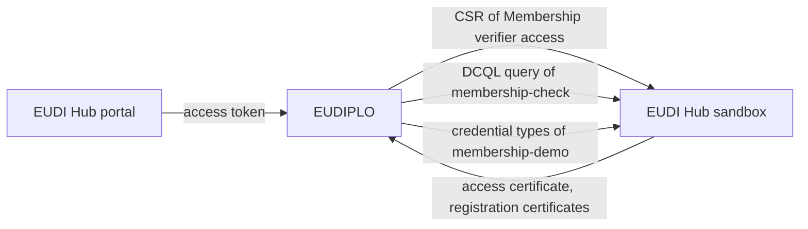

Wallets of the German ecosystem accept a verifier only with an access certificate from the German registrar, the EUDI Hub, and show what it may request from its registration certificate. In this recipe you replace the self-signed access certificate of `membership-check` with one from the EUDI Hub sandbox, and add registration certificates for the verifier and the issuer. The [EUDI Hub](../trust/eudi-hub.md) guide describes every field and error.

## What you will build

The access key chain `Membership verifier access` keeps its key and gets a certificate from the EUDI Hub. `membership-check` attaches a registration certificate for its DCQL query to every request, and the credential issuer metadata of `membership-demo` publishes one for the `membership` credential.



## Before you start

- **Starts from:** [Issue and verify](index.md): tenant `membership-demo` with the access key chain `Membership verifier access`, the credential configuration `membership` and the presentation configuration `membership-check`.
- The client `membership-demo-admin` holds `registrar:manage`, which chapter 2, step 1 adds only if your wallet needs registrar certificates. If it is missing, add it to the client under **Administration → API Clients** and sign in again. Without `tenant:admin`, a client cannot add a role to itself: a client or user that may grant it must add it ([granting roles](../reference/roles.md#granting-roles)).
- An account in the [EUDI Hub portal](https://portal.eudi-hub.gov.de/) assigned to an organization that may request certificates in the sandbox. Create and verify the organization in the portal; EUDIPLO does not do that.
- Your organization's official identifier (for example its EUID or Handelsregisternummer), a privacy policy URL, a support URL and a general web address.
- If `OUTBOUND_URL_ALLOWED_HOSTS` is set, it lists `api.eudi-hub.gov.de` and the host of the EUDI Hub's issuing CA ([prerequisites](../trust/eudi-hub.md#prerequisites)).
- `curl` and `jq` for the checkpoints, with a token of `membership-demo-admin`:

```bash
export EUDIPLO=http://localhost:3000
read -rs ADMIN_SECRET
ADMIN_TOKEN=$(curl -s -X POST "$EUDIPLO/api/oauth2/token" \
  -d grant_type=client_credentials -d client_id=membership-demo-admin \
  --data-urlencode client_secret="$ADMIN_SECRET" | jq -r .access_token)
```

## Step 1: Copy an access token from the portal

EUDIPLO acts at the EUDI Hub with the access token of your portal session. It is valid for a few minutes and is never stored, so copy a fresh one right before each of the next steps:

1. Sign in to the [EUDI Hub portal](https://portal.eudi-hub.gov.de/) and open the developer tools of your browser on the **Network** tab.
2. Open **Access certificates** in the portal and select a request to `api.eudi-hub.gov.de`.
3. Copy the value of its `Authorization` request header.

Treat the token like a password: until it expires, it acts as your portal user.

**Checkpoint:** the copied value starts with `Bearer eyJ` or `eyJ`.

## Step 2: Get the access certificate

1. Open **Cryptographic Assets → Keys**, select `Membership verifier access` and choose **Request from EUDI Hub** on its **Active Certificate** card.
2. Paste the token into **Access token**, choose **Load Organizations** and select your organization.
3. Keep **Environment** **Sandbox**, enter your **Support URI**, and leave **Certificate name** empty, so the portal shows the key chain's description.
4. Choose **Request Certificate**.

EUDIPLO sends a certificate signing request for the existing key, so the private key never leaves EUDIPLO, and stores the issued certificate together with the CA that issued it.

**Checkpoint:** the **Active Certificate** card shows an **Issuer** of the EUDI Hub that differs from the **Subject**. The portal lists the certificate under **Access certificates**.

## Step 3: Register the verifier

Request the registration certificate after the access certificate. EUDIPLO attaches it to every request of `membership-check`, whichever access key chain signs it, so request a new one whenever you change that key chain or its certificate.

1. Copy a fresh access token (step 1).
2. Open **Credential Verification → Verification Configs**, select `membership-check`, go to the **Security** tab and choose **Request from EUDI Hub** on the **Registration Certificate** card.
3. Paste the token and select the organization. EUDIPLO fills empty fields with what the EUDI Hub knows about the organization.
4. Complete the fields the EUDI Hub needs:
    - **Identifier type** and **Identifier**, as in the official record.
    - **Service description (German)** `Prüfung von Vereinsmitgliedschaften` and **Service description (English)** `Club membership checks`.
    - **Purpose (German)** `Prüfung Ihrer Vereinsmitgliedschaft` and **Purpose (English)** `Check your club membership`.
    - **Privacy policy**, **Support URI** and **Info URI**.
5. Keep **Sandbox** and choose **Request Certificate**.

EUDIPLO registers a credential request for `urn:example:membership:1` with the claims `name` and `member_id` at the EUDI Hub, or reuses one with the same content, and stores the certificate in `registration_cert`.

**Checkpoint:** the certificate authorizes exactly the DCQL query, and its expiry date is in the future:

```bash
curl -s "$EUDIPLO/api/verifier/config/membership-check" -H "Authorization: Bearer $ADMIN_TOKEN" \
  | jq -r .registration_cert.jwt \
  | jq -R 'split(".")[1] | gsub("-";"+") | gsub("_";"/") | @base64d | fromjson
      | {exp: (.exp | todate), credentials}'
```

## Step 4: Register the issuer

1. Copy a fresh access token (step 1).
2. Open **Credential Issuance → Issuer Settings**, go to the **Registration Certificate** tab and choose **Request from EUDI Hub**.
3. Paste the token, select the organization, and complete **Identifier**, **Service description**, **Support URI** and **Info URI** as in step 3.
4. Keep **Sandbox** and choose **Request Certificate**.

EUDIPLO registers the VCT of every credential configuration of the tenant as a credential issuance, here `urn:example:membership:1` (also for `membership-untrusted` if you followed [Accept only trusted issuers](trusted-issuers.md)), and turns the registration certificate on.

**Checkpoint:** the credential issuer metadata publishes the certificate:

```bash
curl -s "$EUDIPLO/.well-known/openid-credential-issuer/issuers/membership-demo" \
  | jq '.issuer_info[0].format'
```

The answer is `"registration_cert"`.

## Step 5: Present the credential again

Generate a new request for `membership-check` and scan it with your wallet, as in [chapter 3, step 5](first-presentation.md#step-5-generate-and-approve-a-request). The request object is now signed with the EUDI Hub access certificate and carries the registration certificate as `verifier_info`.

**Checkpoint:** the presentation session is `completed`. A wallet that reads registration certificates shows your organization and the purpose from step 3.

## Troubleshooting

| Symptom | Cause | Fix |
| --- | --- | --- |
| `400` naming HTTP 401 of the EUDI Hub | The portal token has expired or was not copied completely | Copy a fresh token (step 1) and request again. |
| `400` naming HTTP 403 of the EUDI Hub | Your portal user may not request certificates for this organization | Ask the organization's administrator in the portal for the permission. |
| **Request from EUDI Hub** is missing or locked | `membership-demo-admin` lacks `registrar:manage`, or the configuration is provisioned from a configuration file | Use a client with the role; change provisioned configurations in their files. |
| Saving a changed DCQL query of `membership-check` fails with `400` | The registration certificate does not cover the new query ([Overasking check](../trust/registration-certificates.md#overasking-check)) | Clear the registration certificate in the same save, then request a new one for the saved query (step 3). |
| Requests to `membership-check` fail with `400` | The registration certificate has expired | Request a new registration certificate (step 3). |

Status codes and retries after an EUDI Hub failure are listed under [Errors](../trust/eudi-hub.md#errors). General problems are covered in [Troubleshooting](../troubleshooting.md).

## Next steps

- [EUDI Hub](../trust/eudi-hub.md): every field, the API calls and the Live environment.
- [Registration certificates](../trust/registration-certificates.md): how wallets and EUDIPLO check them.
- [Wallet and registrar requirements](../trust/wallet-registrars.md): which wallets need which certificates.
