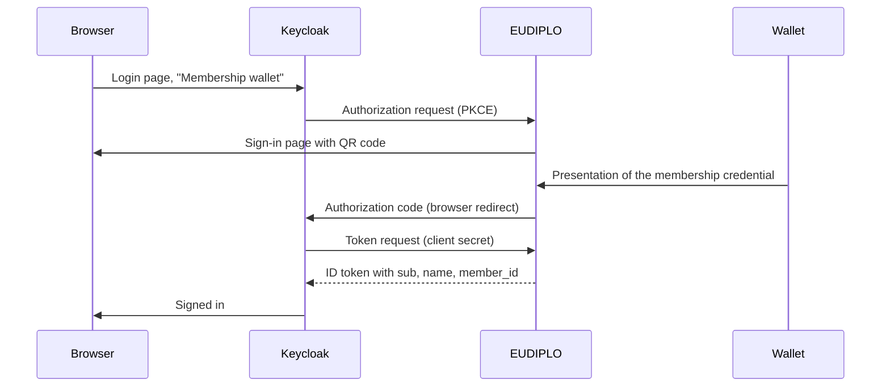

Keycloak can use EUDIPLO as an external identity provider: the user chooses **Membership wallet** on the Keycloak login page, presents the membership credential, and Keycloak signs them in. Every application behind Keycloak gets wallet sign-in without code of its own.

## What you will build

An OpenID Connect client `Keycloak` in the tenant `membership-demo` that verifies sign-ins with the presentation configuration `membership-check`, and an identity provider `membership-wallet` in a Keycloak realm that uses it. `member_id` identifies the user, so the same member always lands in the same Keycloak account.



## Before you start

- **Starts from:** [chapter 3, Verify the membership credential](first-presentation.md). `membership-check` verifies `name` and `member_id`, and the wallet holds the membership credential.
- A Keycloak 26 realm you administer, reachable from the user's browser, and able to reach EUDIPLO's public URL. In the examples Keycloak runs at `https://YOUR-KEYCLOAK-HOST` with the realm `demo`.
- A token of the client `membership-demo-admin` from [chapter 2](first-credential.md), which has `presentation:manage`; [Integrate into your backend](integrate-backend.md#before-you-start) shows the token request.

## Step 1: Register Keycloak as a client

Keycloak's broker endpoint receives the authorization code. Its URL is `https://YOUR-KEYCLOAK-HOST/realms/demo/broker/membership-wallet/endpoint`, where `membership-wallet` is the identity provider alias you use in step 2.

```bash
curl -X POST "https://YOUR-HTTPS-HOST/api/verifier/oidc-clients" \
  -H "Authorization: Bearer $TOKEN" -H "Content-Type: application/json" \
  -d '{
    "name": "Keycloak",
    "redirectUris": ["https://YOUR-KEYCLOAK-HOST/realms/demo/broker/membership-wallet/endpoint"],
    "profile": "basic",
    "scopes": [{ "scope": "membership", "presentationConfigId": "membership-check" }],
    "subject": { "credentialId": "membership", "claim": "member_id" },
    "claimsFrom": "membership"
  }'
```

- `profile: basic`: Keycloak's identity provider sends the authorization request through the browser and does not push it first.
- `subject`: `sub` becomes a hash of `member_id` and of the issuer, so Keycloak recognizes a returning member. `membership-check` names `membership-issuers` under `trusted_authorities`, which `subject` requires.
- `claimsFrom`: `name` and `member_id` also appear at the top level of the ID token, where Keycloak's mappers read them.

**Checkpoint:** the response contains `id` (the client ID), `clientSecret` and `issuer`. Store the secret now; it is not shown again. `https://YOUR-HTTPS-HOST/verifiers/membership-demo/oidc/.well-known/openid-configuration` now returns the discovery document.

## Step 2: Add the identity provider in Keycloak

In the Keycloak admin console, open the realm `demo`, then **Identity providers → OpenID Connect v1.0**, and enter:

| Field | Value |
| --- | --- |
| Alias | `membership-wallet` |
| Display name | `Membership wallet` |
| Discovery endpoint | `https://YOUR-HTTPS-HOST/verifiers/membership-demo/oidc/.well-known/openid-configuration` |
| Client authentication | Client secret sent as basic auth |
| Client ID / Client Secret | `id` and `clientSecret` from step 1 |

Save, then on the provider's **Settings** tab set:

| Field | Value |
| --- | --- |
| Use PKCE | On, method `S256` |
| Validate signatures / Use JWKS URL | On |
| Disable user info | On: everything is in the ID token |
| Scopes | `openid membership` |
| Sync mode | Force |

Leave **Logout URL** empty: EUDIPLO keeps no session to end.

**Checkpoint:** the discovery endpoint filled in the authorization, token and JWKS URLs and the issuer `https://YOUR-HTTPS-HOST/verifiers/membership-demo/oidc`.

## Step 3: Map the claims to the Keycloak account

On the provider's **Mappers** tab, add:

| Name | Mapper type | Settings |
| --- | --- | --- |
| `username` | Username Template Importer | Template `${ALIAS}.${CLAIM.member_id}` |
| `first name` | Attribute Importer | Claim `name`, User attribute `firstName` |
| `member id` | Attribute Importer | Claim `member_id`, User attribute `member_id` |

A user attribute other than the built-in ones must exist in **Realm settings → User profile** before the mapper can write it; add `member_id` there.

The membership credential carries no email address and no last name, which Keycloak's default user profile requires. Its first login flow then asks for them once (**Review profile**). Either let members enter them there, or make **email** and **lastName** optional in **Realm settings → User profile**.

**Checkpoint:** three mappers are listed.

## Step 4: Sign in

Open the account console of the realm, `https://YOUR-KEYCLOAK-HOST/realms/demo/account`, and choose **Membership wallet** on the login page. EUDIPLO shows the sign-in page: scan the QR code with the wallet, or open the wallet on the same device, and share the credential.

**Checkpoint:** the account console shows you signed in, with the first name from the credential. In the admin console, **Users** lists `membership-wallet.m-001` (Keycloak lowercases usernames), and its **Identity provider links** tab shows `membership-wallet` with a user ID that is a hash, not `M-001`.

Sign out and sign in again with the wallet. Keycloak signs you in to the same account and does not ask for the profile again.

To skip the Keycloak login page, send users straight to the wallet with `kc_idp_hint=membership-wallet` on your application's authorization request.

## Troubleshooting

| Symptom | Cause | Fix |
| --- | --- | --- |
| EUDIPLO shows "The application must push its authorization request first" | The client has the `secure` profile | `PATCH` the client with `"profile": "basic"` |
| EUDIPLO's page says the `redirect_uri` is not registered | Alias or realm in the redirect URI differ from Keycloak's | Copy the **Redirect URI** shown on the provider's settings page into `redirectUris` |
| Keycloak returns to its login page with `invalid_scope` | Keycloak sent more scopes than `openid` and one other | Set **Scopes** to exactly `openid membership` |
| Keycloak logs "Invalid token signature" or an algorithm mismatch | The ID token is signed with ES256, ES384 or ES512, as discovery says | Keep **Validate signatures** with **Use JWKS URL**; don't set a fixed RS256 key |
| Every sign-in creates a new Keycloak user | The client has no `subject` | `PATCH` the client with `subject` as in step 1 |
| Keycloak fails after the sign-in with a userinfo error | **Disable user info** is off | Turn it on: EUDIPLO has no userinfo endpoint |
| The sign-in ends with `access_denied` naming `member_id` | The presentation lacks the subject claim | Request `member_id` in `membership-check` |

## Next steps

- [Sign-in with OpenID Connect](../presentation/openid-connect.md): every client setting, `acr` and same-device sign-in.
- [Keycloak SSO](../operate/keycloak.md): use Keycloak for EUDIPLO's own management login.
- [Accept only trusted issuers](trusted-issuers.md): what happens when a credential comes from another issuer.

An end-to-end test runs the same client and identity provider settings against Keycloak 26, with a PID instead of the membership credential (`apps/backend/test/presentation/oidc-provider.e2e-spec.ts`).
